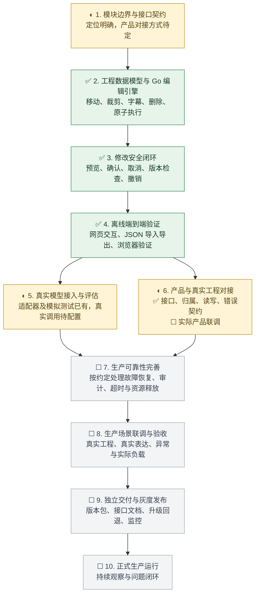

# 安全剪辑 Agent：生产模块开发步骤与进度

更新：2026-11-11。定位：面向 ToC 产品、可独立交付的安全剪辑 Agent 模块。本次已重新执行 Go 测试、静态检查、构建、20 项真实 HTTP 检查及网页兼容性回归。

生产使用是交付目标。当前已有可运行的核心实现和离线网页闭环，尚未完成生产交付。先前取消的 50 人并发及压测目标保持取消；生产运行需要的实际容量指标由模块调用方式和业务指标另行确定。

✅ 已实现并有验证记录；◐ 部分完成；☐ 待开始或待外部条件。

## 开发步骤及完成标准

| 步骤 | 工作内容 | 完成标准 | 当前状态 |
|---|---|---|---|
| 1. 定义模块契约 | 确定独立 HTTP 服务或其他调用方式、工程输入输出、调用身份、状态和错误格式；明确账号、保存、恢复的责任归属 | 调用方可依据版本化接口文档接入；未决项列明 | ◐ 版本化 HTTP 接口及契约已交付；实际产品身份和格式待确定 |
| 2. 实现编辑引擎 | 工程格式、整数毫秒时间、素材边界、锁轨、重叠、四类操作及顺序执行 | 合法指令正确执行，非法或第二步失败时无部分修改 | ✅ 已实现及测试；累计缩短问题已修复 |
| 3. 完成安全交互 | 实际差异预览、明确确认、取消、加载标识、版本、过期和重复请求保护、按整条指令撤销 | 预览不修改，确认与预览一致；旧计划及重复确认拒绝 | ✅ 已实现，Go 测试和浏览器行为验证有记录 |
| 4. 验证离线链路 | 网页消息、候选澄清、工程导入、JSON 下载与重新导入 | 不依赖模型即可完成完整编辑流程；桌面和手机布局可用 | ✅ 已验证；这是开发验证完成，不代表生产接入完成 |
| 5. 接通真实模型 | 接口配置、真实自由表达、补充回答、模型失败和非法输出评估 | 使用真实接口及业务表达评估正确率、澄清率、误操作和响应耗时；达标阈值另定 | ◐ 适配器、超时和模拟测试已有；缺真实模型配置 |
| 6. 接入产品和真实工程 | 对接调用方、实际工程格式及素材引用；绑定用户和工程归属；传递可操作的错误 | 实际工程可正确往返，调用者不能操作他人工程；数据和版本一致 | ◐ ✅ 模块接口、身份归属、条件读写、错误契约已实现并验证；☐ 实际产品链路待联调 |
| 7. 完善生产可靠性 | 根据职责归属完善故障恢复、保存失败处理、操作审计、日志脱敏、超时取消、资源释放及模型调用限制 | 异常退出、网络中断和失败重试的结果明确且可恢复；数据保留与清理行为符合约定 | ☐ 已有部分超时和数量限制，生产可靠性整体验收未完成 |
| 8. 进行生产验收 | 真实工程、多轮自由表达、版本冲突、断网、重启、恶意输入和实际业务负载；完成竞态检查 | 验收用例、指标和残留问题均有记录；满足约定交付门槛 | ☐ 离线回归已有，真实模型和生产集成回归待完成；不自动恢复 50 人目标 |
| 9. 独立发布 | 版本化产物、配置和接口文档、兼容性、监控、灰度、升级与回退 | 调用方能独立安装或集成；可定位失败并恢复到上一版本 | ☐ README 和基础构建已有，完整发布流程未完成 |
| 10. 生产运行 | 观察失败率、耗时及业务反馈，持续修复 | 指定负责人、告警和缺陷处理流程；满足业务指标 | ☐ 待上线 |

## 当前处于哪一步

已走通第 2—4 步，并完成第 6 步的通用模块实现：版本化接口、校验后的用户归属、条件工程读写、统一错误契约、身份和格式适配入口。第 5 步待真实模型配置，第 6 步待真实产品的格式和身份方式确定后联调；当前不代表生产交付完成。

最近一次记录显示：Go 测试、构建、静态检查及前端语法检查通过；浏览器验证覆盖累计缩短、确认取消、撤销、锁轨、原子拒绝、澄清和导出再导入。竞态检测因 cgo 环境未就绪没有运行成功。真实模型和生产集成尚未验收。

## 接下来优先推进

1. 按已交付的 /api/v1 接口契约，确定实际产品工程格式和身份方式，实施对应适配及真实产品联调。
2. 有模型配置后立刻进行真实模型联调；配置未到前继续准备真实业务用例和工程适配。
3. 根据模块职责完善数据可靠性及故障恢复，保持现有明确确认和版本保护。
4. 在真实调用链上回归，通过生产门槛后再灰度发布。

现有持久化行为仍按此前约定：工程、会话和撤销在进程内存中，点击导出保存 JSON，进程重启后未导出修改及撤销历史不恢复。生产场景若继续接受此行为，应明确写入契约；若不能接受，再实施约定的保存和恢复方案，不能自行假定已有数据库或必须新建一套账号系统。

默认端口已恢复为 8090，并通过不设置 LISTEN_ADDR 的独立程序启动验证。接口说明、OpenAPI 和阶段 6 验收记录已写入工程 docs。工程内进度文档配套链接：[产品接口](产品接口-v1.md)、[阶段 6 验收记录](阶段6验收记录.md)。
